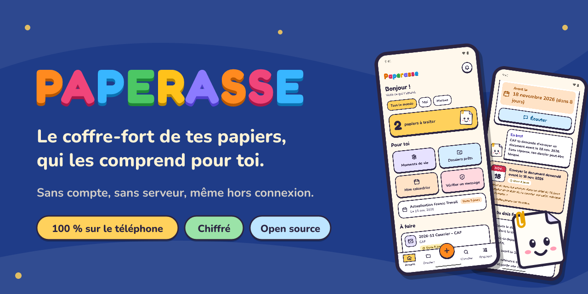
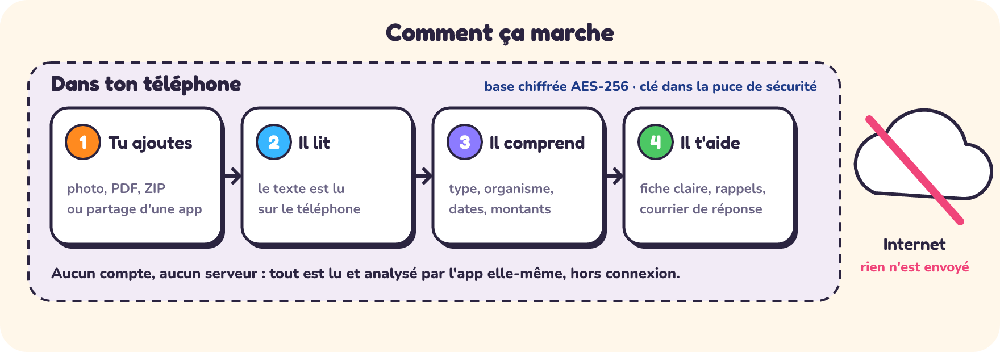
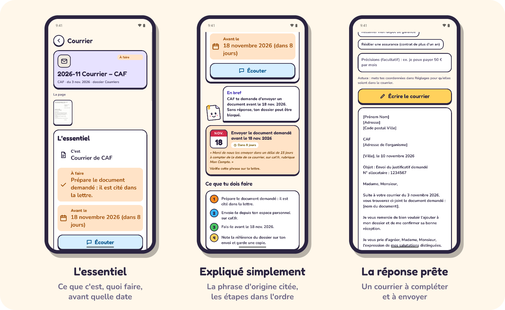
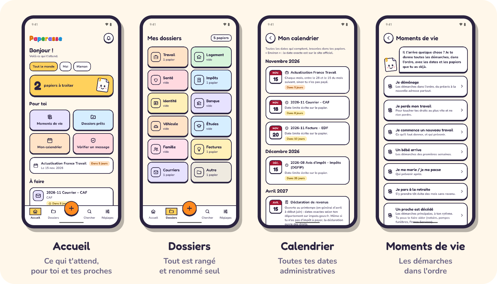
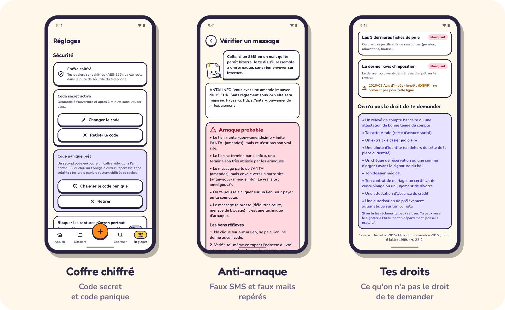

<p align="center">
  
</p>

<p align="center">
  <a href="https://ko-fi.com/paperasse"></a>
  <a href="LICENSE"></a>
  
  
  
</p>

<p align="center">
  <a href="#comment-ça-marche">Comment ça marche</a> ·
  <a href="#comprendre">Comprendre</a> ·
  <a href="#ranger-toute-une-vie">Ranger</a> ·
  <a href="#protéger">Protéger</a> ·
  <a href="#feuille-de-route">Feuille de route</a> ·
  <a href="#pour-les-développeurs">Développeurs</a> ·
  <a href="#soutenir-le-projet">Soutenir</a>
</p>

---

Une lettre de la CAF, un avis d'impôt, une amende, un contrat de travail : des papiers écrits pour être compris par des spécialistes, avec une date limite cachée au milieu d'un paragraphe.

**Paperasse** les prend en photo, les lit, les range et te les explique en quelques lignes : ce que c'est, ce qu'il faut faire, avant quelle date. Il te prévient à temps, prépare la réponse et garde tout dans un coffre chiffré.

Et tout se passe **sur ton téléphone**. Pas de compte à créer, pas de serveur, pas d'abonnement. Tes papiers ne partent nulle part.

## Comment ça marche

<p align="center">
  
</p>

Le texte est lu sur l'appareil, puis le moteur de Paperasse (écrit pour ça, en TypeScript, sans service extérieur) reconnaît le type de papier, l'organisme, les dates, les montants et les références. Il ne devine pas : chaque date limite affichée vient avec **la phrase exacte du papier** qui la justifie.

### Exemple : un courrier de la CAF

| Sur le papier | Ce que Paperasse en fait |
|---|---|
| « Merci de nous les envoyer dans un délai de 15 jours à compter de la date de ce courrier » (daté du 3 novembre) | **Date limite : 18 novembre**, phrase citée, rappels avant l'échéance |
| Une demande de justificatif noyée dans le texte | « Prépare le document demandé », puis les étapes dans l'ordre |
| N° allocataire, adresse | Rangés dans les infos utiles, **masqués** quand tu partages le texte |
| Un courrier d'organisme | Dossier *Courriers*, « à garder jusqu'au 3 nov. 2031 » (avec la raison) |
| Rien à répondre ? Si : envoyer la pièce | Un courrier « Envoi du justificatif demandé » prêt à compléter |

## Comprendre

<p align="center">
  
</p>

- **L'essentiel en trois lignes** : ce que c'est, quoi faire, avant quand. Un mode *facile à lire* l'affiche en gros, et un bouton le **lit à voix haute**.
- **Explication en 4 langues** : français, anglais, espagnol et arabe, pour comprendre un papier français même si ce n'est pas ta langue.
- **Les mots difficiles** expliqués sur place (allocataire, recours gracieux, trop-perçu…).
- **Courriers de réponse** prêts à envoyer : demander un délai de paiement, contester, demander des explications, envoyer un justificatif, résilier un contrat ou une assurance, recours gracieux, réclamer une somme ou un dépôt de garantie.
- **Code 2D-Doc** des papiers officiels lu et comparé au texte du papier, d'après la spécification de l'ANTS : factures, banque, impôts, travail, mais aussi titres d'identité et de séjour, actes de commissaire de justice, véhicules (certificat qualité de l'air, cession), permis de conduire, diplômes, certificat de décès, preuve de vie, demande d'asile, vaccination. Sur Android, le code est cherché dès l'ajout de la photo : sa date de fin de validité arrive dans les rappels.
- **Vérification de la fiche de paie** : taux horaire comparé au SMIC en vigueur à la date de la paie, calcul brut − cotisations = net vérifié.

## Ranger toute une vie

<p align="center">
  
</p>

- **Ajouter en un geste** : photo, PDF (même scanné), plusieurs fichiers, archive ZIP, ou *Partager vers Paperasse* depuis Mail, WhatsApp ou Fichiers.
- **Scanner malin** : photo floue, trop sombre ou avec un reflet signalée avant d'enregistrer, feuille recadrée.
- **Rangé et renommé tout seul** dans 12 dossiers (Travail, Logement, Santé, Impôts, Identité, Banque…).
- **Pas de doublon** : le même papier ajouté deux fois (même photo, même PDF, ou rephotographié) est repéré, et Paperasse propose de garder l'ancien. Deux factures du même fournisseur ne sont pas confondues : dates, montants et numéros doivent aussi correspondre.
- **Calendrier administratif** : les dates trouvées dans tes papiers et les grandes échéances de l'année (déclaration de revenus, actualisation France Travail…).
- **Moments de vie** : déménagement, perte d'emploi, nouveau travail, naissance, mariage ou Pacs, retraite, décès d'un proche. Les démarches dans l'ordre, avec les papiers que tu as déjà.
- **Dossiers prêts** (location, prêt, titre de séjour, embauche) : ce qui est prêt, ce qui manque, ce qu'**on n'a pas le droit de te demander**, puis un seul PDF avec un **filigrane** sur chaque page (« Uniquement pour la location d'un logement — Agence Martin — 10/11/2026 »).
- **Argent à récupérer**, durées de conservation (« tu peux jeter »), recherche dans tous tes papiers.
- **Partager un papier** : toutes ses pages réunies en un seul PDF, **protégé par un mot de passe** (AES-256, proposé tout fait, à donner à part). Même protection pour les dossiers prêts et le dossier pour un accompagnant.
- **Famille et aidants** : un profil par proche (« Maman », un enfant…) pour gérer aussi leurs papiers.
- **Dossier pour un accompagnant** (assistante sociale, CCAS, France Services) : les papiers choisis, les tiens ou ceux d'un proche, en un seul PDF avec le résumé de chacun en première page et un filigrane au nom de la personne.
- **Widget « Prochaine échéance »** (Android) : sur l’écran d’accueil du téléphone, la prochaine date limite ou expiration (« Dans 3 jours », « + 2 autres bientôt »), sans ouvrir l’app. Avec un code secret, il ne dit jamais de quel papier il s’agit ; coffre leurre ouvert, il reste vide.
- **Doux au toucher** : les boutons s'enfoncent avec un petit son feutré et une vibration légère, les écrans glissent. Muet en mode silencieux, jamais par-dessus ta musique, réglable dans *Réglages → Sons et vibrations* ; les mouvements s'arrêtent si ton téléphone demande de réduire les animations. Le pavé du code secret vibre mais ne fait aucun bruit.

## Protéger

<p align="center">
  
</p>

| Protection | Ce que ça fait |
|---|---|
| **Coffre chiffré** | La base des papiers est chiffrée (SQLCipher, AES-256). La clé reste dans la puce de sécurité du téléphone. |
| **Code secret** | Demandé à l'ouverture et après une minute sans utiliser l'app. Attente croissante après plusieurs erreurs. Les rappels ne montrent plus le nom des papiers sur l'écran verrouillé. |
| **Code panique** | Un second code qui ouvre un coffre vide, d'apparence normale. Les vrais papiers restent chiffrés et cachés, et leurs rappels se taisent. |
| **Captures d'écran** | Toujours bloquées sur les pièces sensibles (identité, banque, santé), et partout si tu le choisis. |
| **Sauvegarde** | Un seul fichier chiffré de bout en bout, à ranger où tu veux. Sans ta clé de secours, personne ne peut l'ouvrir. L'accueil te rappelle quand la dernière sauvegarde devient trop vieille ou que des papiers n'y sont pas. |
| **Sauvegarde automatique** (Android) | Choisis un dossier une fois (Google Drive, clé USB, carte SD) : une sauvegarde chiffrée y part chaque semaine, et dès que tu ajoutes des papiers. Les trois dernières sont gardées. |
| **Kit d'urgence** | Une sauvegarde et une fiche à confier à un proche, au cas où. |
| **Sélecteur d'apps** | Dès que tu quittes l'app, son aperçu dans le sélecteur d'apps ne montre que la mascotte, jamais un papier. |
| **Anti-arnaque** | Faux SMS ANTAI, Ameli, CPF, colis, banque : les liens et les tournures typiques sont repérés. Une arnaque probable n'est jamais classée « à payer ». |
| **Bouclier vie privée** | Le texte d'un papier peut être partagé avec les numéros personnels masqués (IBAN, sécurité sociale, numéro fiscal…). |

Les copies temporaires (photo prise par l'appareil, PDF choisi) sont effacées dès que le papier est rangé, et le cache de l'app est nettoyé à chaque ouverture du coffre.

Ce qui n'est **pas encore** chiffré : les images des pages, rangées dans l'espace privé de l'app (le chiffrement est sur la feuille de route).

## Fiabilité

L'analyse est testée sur un banc d'essai qui grandit à chaque bug trouvé :

- **140 papiers fictifs annotés** (CAF, impôts, amendes, fiches de paie, contrats, pièces d'identité, factures…) et plus de 1 000 variantes générées ;
- des **pièges relevés sur de vrais papiers**, puis réécrits avec des données inventées : date d'une loi prise pour la date du courrier, délai d'une clause pris pour une date limite, adresse officielle mal lue sur un scan prise pour une arnaque… Aucun vrai papier n'est gardé ;
- des **photos mal lues simulées** (lettres et chiffres confondus, accents perdus, lignes coupées ou mélangées, parasites) ;
- des milliers de textes aléatoires pour vérifier que rien ne plante ni ne ralentit ;
- un **lot écrit à l'aveugle**, après réglage : 91,7 % des champs justes du premier coup ;
- les **67 exemples officiels de l'ANTS** pour le 2D-Doc, recopiés à l'octet près : chaque signature est vérifiée avec le certificat de test de la spécification.

Paperasse peut se tromper : vérifie toujours les dates et les montants sur le papier. Il ne remplace pas un conseiller.

## Feuille de route

- [x] Lecture des photos et des PDF, explication en 4 langues, rappels
- [x] Coffre chiffré, code secret, code panique, sauvegarde chiffrée, kit d'urgence
- [x] Scanner, 2D-Doc, dossiers prêts filigranés, moments de vie, profils famille
- [x] Sauvegarde automatique (Android), mise en page tablette et petits écrans, explications en arabe de droite à gauche
- [ ] Publication sur le Play Store
- [ ] Version iPhone
- [ ] Chiffrement des images des pages
- [x] PDF protégé par mot de passe, dossier pour un travailleur social
- [ ] Essais sur 100 vrais courriers anonymisés
- [ ] Plus de langues (portugais, turc, roumain, ukrainien…) et d'autres pays (Belgique, Suisse, Québec, Maghreb…)

## Questions

<details>
<summary><b>C'est vraiment gratuit ?</b></summary>
<br>
Oui, sans publicité et sans abonnement. Le code est libre (AGPL-3.0). Le projet vit des dons sur <a href="https://ko-fi.com/paperasse">Ko-fi</a>.
</details>

<details>
<summary><b>Mes papiers partent-ils sur un serveur ?</b></summary>
<br>
Non. Il n'y a pas de serveur Paperasse. La lecture, l'analyse, les rappels et les sauvegardes se font sur le téléphone. Une sauvegarde ne quitte l'appareil que si tu choisis toi-même où l'envoyer, et elle est chiffrée avant.
</details>

<details>
<summary><b>Et si je perds mon téléphone ?</b></summary>
<br>
Fais une sauvegarde chiffrée de temps en temps et garde ta clé de secours sur papier. Sur un nouveau téléphone, <i>Restaurer une sauvegarde</i> remet tout en place.
</details>

<details>
<summary><b>Et si j'oublie mon code ?</b></summary>
<br>
Après quelques essais, Paperasse propose de déverrouiller avec l'empreinte ou le visage enregistrés sur le téléphone. Sinon, la sauvegarde chiffrée reste la solution.
</details>

<details>
<summary><b>Quand sur iPhone ?</b></summary>
<br>
L'app est écrite avec Expo et React Native, donc prévue pour iPhone, mais elle n'y a pas encore été essayée. C'est l'un des premiers usages des dons.
</details>

## Pour les développeurs

**Pile** : Expo SDK 58, React Native 0.88, React 19, TypeScript strict, Expo Router, expo-sqlite avec SQLCipher, expo-secure-store, ML Kit (lecture du texte, modèle intégré à l'app), pdf-lib, fflate, @noble/hashes, @noble/ciphers, expo-audio et expo-haptics (sons et vibrations de l'interface), react-native-android-widget (widget Android).

### Démarrer

Prérequis : Node.js 20+, Java 17, SDK Android (plateforme 37, NDK 27.1, CMake 3.31.6), un émulateur ou un téléphone Android.

```bash
cd mobile
npm ci --legacy-peer-deps
npx expo run:android
```

Ensuite, tant qu'aucun module natif ne change : `npx expo start --dev-client`.

**Sur iPhone sans Mac**, avec Expo Go : un compte Expo gratuit, connecté sur l'ordinateur (`npx expo login`) et dans Expo Go, l'identifiant d'un projet expo.dev dans `mobile/.env.local` (`EAS_PROJECT_ID=…`, fichier jamais envoyé sur le dépôt), puis `npx expo start --go`. Expo Go ne lit pas les photos et n'a pas le coffre chiffré : pour tout essayer, il faut un vrai build.

`mobile/android/` est généré par `npx expo prebuild` : les réglages natifs passent par `mobile/app.json` et `mobile/plugins/`.

### Vérifier

```bash
cd mobile
npm test                  # moteur, formats et sécurité
npx tsc --noEmit          # types de l'app
npm run typecheck:tests   # types des tests
npx expo lint             # lint
npm run fiabilite         # rapport de fiabilité de l'analyse
```

### Organisation

| Dossier | Contenu |
|---|---|
| `mobile/src/engine/` | Moteur d'analyse et formats (PDF, sauvegarde, 2D-Doc, scanner…), en TypeScript pur, testé sous Node |
| `mobile/src/lib/` | Base de données, fichiers, coffre chiffré, sauvegarde, rappels |
| `mobile/src/app/` | Écrans (Expo Router) |
| `mobile/src/components/` | Interface (thème, boutons, mascotte, icônes) |
| `mobile/src/widget/` | Dessin du widget Android « Prochaine échéance » (son contenu : `src/lib/widgetData.ts`, testé) |
| `mobile/plugins/` | Plugins de configuration Expo (modèle de lecture intégré, CMake) |
| `mobile/scripts/` | Outils : rapport de fiabilité, images de la marque, sons de l'interface (`npm run sounds` les refabrique dans `assets/sounds/`) |
| `mobile/test/` | Tests et corpus de papiers fictifs annotés |

<details>
<summary><b>Détails de sécurité</b></summary>
<br>

- **Base** : SQLCipher (AES-256). Clé aléatoire de 256 bits gardée par expo-secure-store (Android Keystore), accessible seulement téléphone déverrouillé et jamais exportée. Sauvegarde automatique Android désactivée (`allowBackup: false`).
- **Codes** : PBKDF2-SHA256 avec sel aléatoire ; le code secret et le code panique sont vérifiés par une seule dérivation, pour qu'ils prennent le même temps. Attente de 30 s à 1 h après 5 erreurs.
- **Code panique** : ouvre une seconde base chiffrée distincte, avec sa propre clé.
- **Sauvegarde `.paperasse`** : en-tête JSON puis blocs de 1 Mo scellés en AES-256-GCM. Nonce = préfixe aléatoire + compteur, données associées = en-tête + compteur + indicateur de dernier bloc (ni réordonnancement, ni troncature possible). Clé de secours de 140 bits (base32 de Crockford, 2 caractères de contrôle).
- **PDF partagé avec mot de passe** : chiffrement standard des PDF, révision 6 (ISO 32000-2, AES-256) ; chaque chaîne et chaque flux est chiffré, le mot de passe propriétaire est tiré au hasard puis oublié. Vérifié par une seconde mise en œuvre dans les tests et par un lecteur PDF indépendant (Poppler).
- **Réseau** : l'app n'appelle aucun service. Pas de télémétrie, pas de suivi des plantages.

Une faille ? Merci de ne pas ouvrir de ticket public : voir [SECURITY.md](SECURITY.md).
</details>

## Contribuer

Toutes les aides comptent : signaler un bug, un papier mal compris (anonymisé), une règle à ajouter, une traduction, du code. Tout est expliqué dans [CONTRIBUTING.md](CONTRIBUTING.md).

## Soutenir le projet

Paperasse est gratuit, sans publicité, et le restera. Si l'app t'aide, tu peux soutenir son développement sur **[Ko-fi](https://ko-fi.com/paperasse)**, par un don ponctuel ou mensuel. Les dons servent à la version iPhone, à la publication sur les stores et à de nouvelles langues.

<p align="center">
  <a href="https://ko-fi.com/paperasse"></a>
</p>

Sans dépenser un centime :

- mets une étoile au dépôt et parle de Paperasse autour de toi ;
- signale ce qui ne marche pas ;
- aide à traduire les explications dans d'autres langues.

## Licence

[GNU AGPL v3.0](LICENSE) © 2026 ninoelhaj. Tu peux utiliser, étudier, modifier et redistribuer Paperasse ; toute version modifiée distribuée ou proposée en ligne doit rester libre, sous la même licence.
