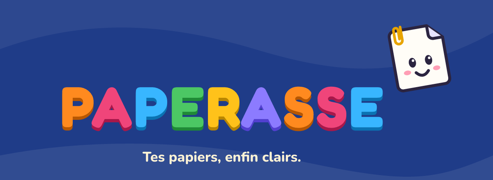

<p align="center">
  
</p>

<p align="center"><b>Le coffre-fort de tes papiers, qui les comprend pour toi.</b><br>
Tout reste sur ton téléphone. Pas de compte, pas de serveur, marche hors connexion.</p>

---

Paperasse range, renomme et explique tes papiers : courriers de la CAF, avis d'impôt, factures, fiches de paie, contrats, pièces d'identité. Il trouve la date limite, te prévient avant, et t'aide à répondre.

Aucune donnée ne quitte le téléphone : la lecture des photos et des PDF, l'analyse, les rappels et les sauvegardes se font sur l'appareil.

## Fonctionnalités

**Comprendre**
- Lecture des photos et des PDF, sur le téléphone.
- Type de papier, organisme, dossier, date limite (avec la phrase d'origine), montant, références.
- Explication simple en 4 langues (français, anglais, espagnol, arabe), mode « facile à lire » et lecture à voix haute.
- Courriers de réponse prêts à envoyer (contestation, délai de paiement, résiliation, dépôt de garantie…).
- Détecteur d'arnaques (faux SMS ANTAI, Ameli, CPF, colis…).
- Lecture du code 2D-Doc des papiers officiels, comparée au texte du papier.

**Ranger toute une vie**
- Partager vers Paperasse depuis Mail, WhatsApp ou Fichiers ; import de plusieurs fichiers ou d'une archive ZIP.
- Scanner : photo floue, sombre ou avec reflet signalée, feuille recadrée.
- Moments de vie (déménagement, naissance, perte d'emploi…), calendrier administratif, argent à récupérer.
- Dossiers prêts à envoyer (location, prêt, préfecture, embauche) en un seul PDF avec filigrane.
- Durées de conservation, vérification de la fiche de paie, profils pour la famille et les proches aidés.

**Protéger**
- Base chiffrée (SQLCipher, AES-256), clé dans la puce de sécurité du téléphone.
- Code secret, code panique qui ouvre un coffre vide, captures d'écran bloquées sur les pièces sensibles.
- Sauvegarde chiffrée de bout en bout, avec une clé de secours que personne d'autre ne connaît.
- Kit d'urgence chiffré à confier à un proche.

## Démarrer

Prérequis : Node.js 20+, Java 17, SDK Android (plateforme 37, NDK 27.1, CMake 3.31.6) et un émulateur ou un téléphone Android.

```bash
cd mobile
npm ci --legacy-peer-deps
npx expo run:android
```

Ensuite, tant qu'aucun module natif ne change : `npx expo start --dev-client`.

Le dossier `mobile/android/` est généré par `npx expo prebuild` : les réglages natifs passent par `mobile/app.json` et `mobile/plugins/`.

## Vérifier

```bash
cd mobile
npm test                  # tests du moteur, des formats et de la sécurité
npx tsc --noEmit          # types
npm run typecheck:tests   # types des tests
npx expo lint             # lint
npm run fiabilite         # rapport de fiabilité de l'analyse
```

## Organisation

| Dossier | Contenu |
|---|---|
| `mobile/src/engine/` | Moteur d'analyse et formats (PDF, sauvegarde, 2D-Doc, scanner…), en TypeScript pur, testé sous Node |
| `mobile/src/lib/` | Base de données, fichiers, coffre chiffré, sauvegarde, rappels |
| `mobile/src/app/` | Écrans (Expo Router) |
| `mobile/src/components/` | Interface (thème, boutons, mascotte, icônes) |
| `mobile/test/` | Tests et corpus de papiers fictifs annotés |

## Contribuer

Les contributions sont les bienvenues : signalement de bugs, papiers mal compris, nouvelles règles, traductions, code. Voir [CONTRIBUTING.md](CONTRIBUTING.md).

Une faille de sécurité ? Ne pas ouvrir de ticket public : voir [SECURITY.md](SECURITY.md).

## Soutenir le projet

- Mets une étoile au dépôt et parle de Paperasse autour de toi.
- Signale ce qui ne marche pas, ou un papier mal compris (anonymisé).
- Aide à traduire les explications dans d'autres langues.

## Licence

[GNU AGPL v3.0](LICENSE) © 2026 vortexturize-ai. Tu peux utiliser, étudier, modifier et redistribuer Paperasse ; toute version modifiée distribuée ou proposée en ligne doit rester libre, sous la même licence.
